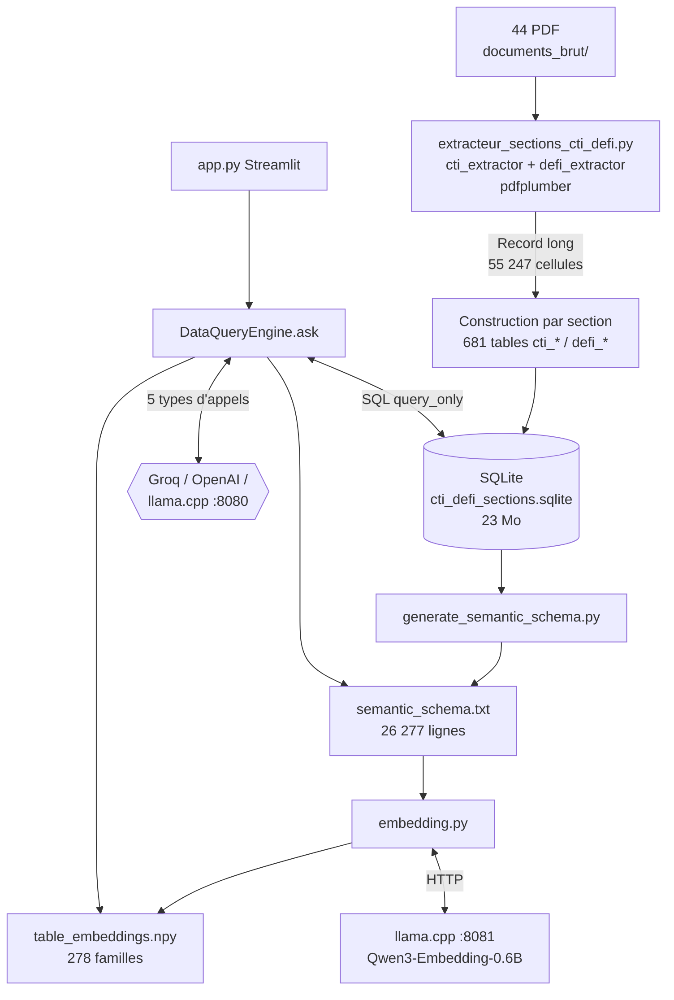
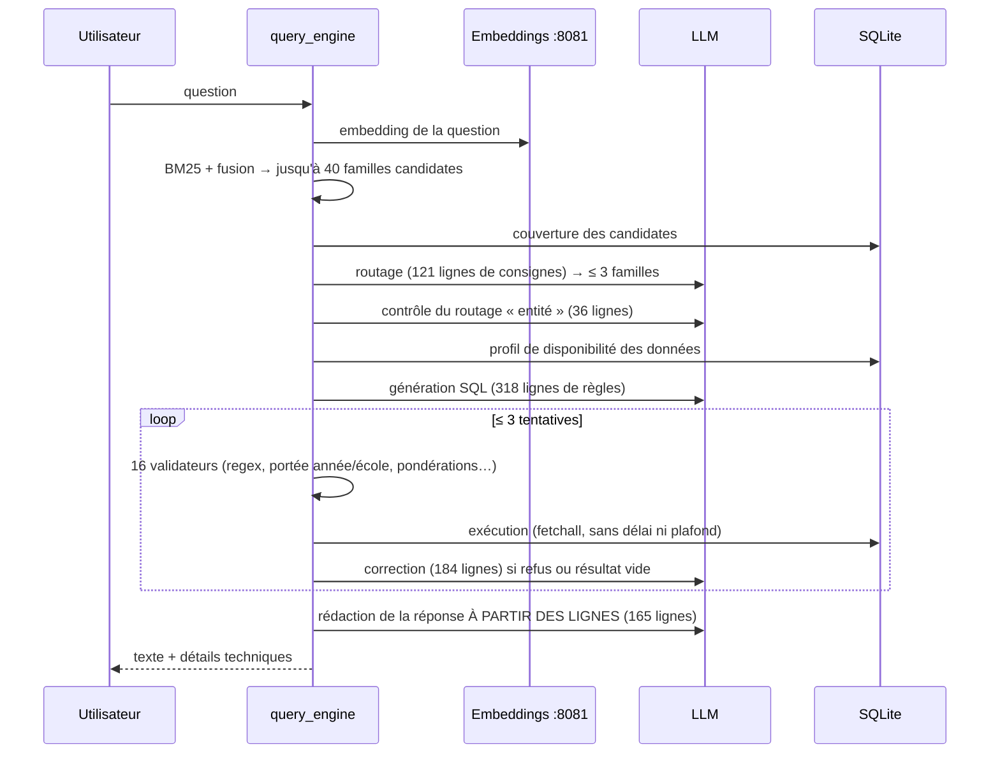
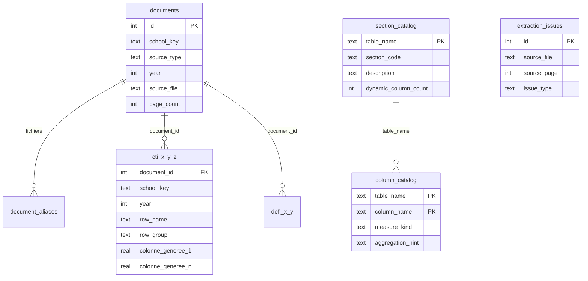

# Audit du prototype `RAG_Polytech` (phase 0)

> Réalisé le 26/11/2026 sur le commit `ccc6a9a` (« Marche avec un LLM local », 23/11/2026) de [`Lex0os/RAG_Polytech`](https://github.com/Lex0os/RAG_Polytech), importé avec son historique dans ce dépôt.
> Machine : Windows 11, Intel i5-1135G7 (4 cœurs), 16 Go de RAM, sans GPU ; Python 3.12.15 (uv 0.13.0).
> Tous les chiffres sont reproductibles avec les scripts de [`docs/audit/scripts/`](audit/scripts/) (voir §9).

## Résumé

1. Le prototype est une application Streamlit au-dessus d'une base SQLite **à une table par section de formulaire** : 681 tables, 18 467 colonnes, dont 2 804 colonnes métier aux noms générés automatiquement.
2. **L'extraction est la partie saine** : 100 valeurs exactes sur 101 contrôlées à la main sur 3 fiches (CTI, DEFI, école hors réseau). Elle est déterministe et prend 547 s pour 44 PDF.
3. **Le stockage est le défaut central.** 89 % des tables CTI sont indexées par un numéro de diplôme propre à chaque école (`D1…D11`). Le LLM doit retrouver la bonne table parmi 278 « familles », d'où un empilement de **16 validateurs ad hoc** et d'environ **820 lignes de prompts**.
4. Coût mesuré : 3 à 6 appels de 5 000 à 7 500 tokens par question, soit **6 à 8 questions par jour** au maximum sur le quota gratuit de Groq.
5. **Rien ne démarre tel quel** : `requirements.txt` est insoluble (4 doublons) et `app.py` plante au lancement (`TypeError`). Deux étapes d'installation ne sont pas documentées, et deux serveurs llama.cpp locaux sont nécessaires.
6. Le **garde-fou SQL** à base d'expressions régulières accepte la lecture de `sqlite_master`, des tables hors sélection, une CTE récursive infinie et des produits cartésiens, sans délai maximal ni plafond de lignes. Les écritures sont, elles, bien bloquées.
7. **Qualité des données** : 4 fichiers portent une campagne fausse dans leur nom (« 2025 » au lieu de 2026) et 1 est un doublon exact. Dijon 2026 est chargé deux fois, d'où un **double comptage** dans toute somme sur le réseau.
8. Les fiches contiennent quelques **données personnelles** (nom du directeur ou de la directrice) : l'hypothèse « aucune donnée personnelle » doit être nuancée.
9. **Formulaires** :
   - CTI : environ 584 codes bruts par campagne, qui se ramènent à **124 indicateurs normalisés**, stables entre 2025 et 2026 (Jaccard 0,98) ;
   - DEFI : la section II est **renumérotée** entre 2024 et 2025 ;
   - CTI et DEFI : 29 codes identiques mais de sens différent.
10. **Recommandation** : refonte ciblée ([ADR 0001](adr/0001-refonte-ou-reprise.md)). On garde les extracteurs, environ 3 700 lignes, et on remplace le stockage (modèle en étoile), le moteur (pipeline configurable et mesuré) et l'interface.

## 1. Méthode

| Étape | Commande (racine du dépôt) | Sortie |
|---|---|---|
| Environnement | `uv venv --python 3.12 .venv-legacy` puis `uv pip install -r requirements.txt` | échec (doublons), puis installation des 61 paquets dédupliqués en 39 s |
| Extraction | `python extracteur_sections_cti_defi.py documents_brut --sqlite cti_defi_sections.sqlite --replace --review-csv review_extraction.csv` | base de 23 Mo, journal |
| Schéma sémantique | `python generate_semantic_schema.py` | `semantic_schema.txt` |
| Index d'embeddings | `llama-server -m Qwen3-Embedding-0.6B-Q8_0.gguf --embedding --pooling last --port 8081`, puis `python embedding.py` | `table_embeddings.npy`, `table_entries.json` |
| Inventaire des codes | `python -X utf8 docs/audit/scripts/inventory_codes.py documents_brut` | [`audit/data/indicator_codes.csv`](audit/data/indicator_codes.csv), [`indicator_inventory.json`](audit/data/indicator_inventory.json) |
| Sonde de sécurité | `python -X utf8 docs/audit/scripts/probe_sql_guard.py` | [`audit/data/probe_sql_guard.json`](audit/data/probe_sql_guard.json) |
| Relevé dans les PDF | `python -X utf8 docs/audit/scripts/show_indicator.py FICHIER CODE…` | réponses attendues de [`baseline_questions.json`](audit/baseline_questions.json) |
| Mesure « avant » | `python -X utf8 docs/audit/scripts/run_baseline.py` | [`audit/data/baseline_results.jsonl`](audit/data/) |

## 2. Cartographie

### 2.1 Structure et volumétrie

| Fichier | Lignes | Rôle |
|---|---|---|
| `query_engine.py` | 5 582 | Moteur : recherche de tables (BM25 + embeddings), routage LLM, génération, 16 validateurs, correction, rédaction de la réponse |
| `cti_extractor.py` | 3 203 | Lecture des fiches CTI (pdfplumber) jusqu'au `Record` long, puis construction des tables par section |
| `defi_extractor.py` | 1 454 | Lecture des fiches DEFI (tableaux, chaires, origine académique) |
| `extracteur_sections_cti_defi.py` | 1 283 | Point d'entrée : documents, sha256, campagne, fusion CTI + DEFI, base par section |
| `generate_semantic_schema.py` | 303 | Description texte des 681 tables pour le LLM |
| `app.py` | 245 | Interface Streamlit (choix du fournisseur en commentant du code) |
| `embedding.py`, `tables_search.py` | 257 | Index et recherche vectorielle (serveur llama.cpp, port 8081) |
| `llm/*.py` | 225 | Fournisseurs Groq, OpenAI, llama.cpp (API compatible OpenAI, port 8080) |
| **Total** | **12 552** | **0 test**, 0 journalisation (`logging`), 0 fichier de configuration |

Fonctions de plus de 150 lignes : `build_unified_section_database` (410), `build_sql_prompt` (328), `ask` (317), `parse_salary_table_records` (262), `route_tables` (237), `validate_parallel_count_components` (234), `parse_table_records` (223), `correct_sql` (220), `generate_final_answer` (218)…

### 2.2 Stack et dépendances

- Python (aucune version déclarée ; testé ici en 3.12), Streamlit 1.65.0, SQLite, pdfplumber 0.11.10 (pdfminer.six 20260107), numpy 2.2.6, pandas 2.3.3, SDK `groq` 1.7.0 et `openai` 3.35.1 (qui tire `httpx2`/`httpcore2`, des paquets légitimes de pydantic/httpx2).
- `requirements.txt` est un `pip freeze` complet de 65 lignes, y compris `pip` et `setuptools==58.1.0`, avec **4 paquets en double à des versions différentes** (`charset-normalizer`, `cryptography`, `pycparser`, `pypdfium2`). Le résolveur échoue : `Because you require pypdfium2==5.12.1 and pypdfium2==5.14.0, … unsatisfiable`.
- Services locaux exigés : un serveur llama.cpp pour le chat (port 8080) et un second pour les embeddings Qwen3-Embedding-0.6B (port 8081). Aucun script ne les lance.

### 2.3 Flux de données

### 2.4 Déroulé d'une question (`DataQueryEngine.ask`)

### 2.5 Schéma de la base actuelle

Chaque table physique `cti_*`/`defi_*` porte **23 colonnes techniques identiques** (provenance, titres, confiance) et 1 à 36 colonnes métier aux noms générés. Exemple : `fisa_fisea_nombre_de_diplomes_ayant_repondu_a_ce_champ_dans_l_enquete`, ou encore `ou_l_etablissement_d_enseignement_superieur_en_convention_sur_le_diplome_et_effectuant_7ca6f7f3`, qui désigne… le nombre d'enseignants-chercheurs.

### 2.6 Prompts

| Prompt | Fonction | Lignes | Observations |
|---|---|---|---|
| Routage | `route_tables` | 121 | Choix de ≤ 3 familles parmi ~40 ; règles de couverture du réseau |
| Contrôle du routage | `validate_or_correct_entity_route` | 36 | Second appel pour corriger le choix d'« entité » |
| Génération SQL | `build_sql_prompt` | 318 | Règles générales **et** règles propres à des questions : convention « label DDRS », synthèse pondérée des salaires, déduplication… |
| Correction | `correct_sql` | 184 | Renvoie l'erreur du validateur au modèle |
| Réponse finale | `generate_final_answer` | 165 | **Reçoit les lignes de résultat** : les données quittent le serveur |

La question et les textes issus des PDF (sujets, libellés, valeurs de dimensions) sont injectés **sans délimitation**. Taille mesurée avec un LLM simulé : **18 000 à 26 000 caractères par appel**, soit environ 5 000 à 7 500 tokens.

### 2.7 Fournisseurs LLM

`GroqProvider` (`openai/gpt-oss-20b`, `reasoning_effort=low`), `OpenAIProvider` (`gpt-5.6-luna`), `LlamaProvider` (llama.cpp via l'API compatible OpenAI). Température 0. On choisit le fournisseur **en commentant ou décommentant des blocs de `app.py`** ; les clés sont lues dans `.streamlit/secrets.toml`, et le dépôt n'a pas de `.gitignore`.

### 2.8 Traitement des PDF (points forts à conserver)

- Codes d'indicateurs repérés dans la marge gauche (x ≤ 45 pt), y compris les codes coupés sur deux lignes (`II.1-D1-` / `7-1`).
- Régions de page délimitées entre ancres successives ; titres et en-têtes de tableaux propagés (`column_path`).
- Analyseur spécialisé des salaires `VIII-D*-7` : salaire et nombre de réponses distingués, montants collés (`410004150041000` → 41 000, 41 500 et 41 000) correctement découpés.
- Tableaux vides structurés, tableaux de chaires DEFI, origine académique (section XI).
- Corrections déterministes tracées dans `extraction_issues` (1 161 lignes, toutes `deterministic_correction` sur les totaux de répondants H + F des sections salaires).
- Campagne lue dans le texte du PDF avant le nom de fichier, et sha256 pour écarter les doublons exacts.

## 3. Exécution réelle

### 3.1 Extraction des 44 PDF

| Mesure | Valeur |
|---|---|
| Documents | 44 fichiers → **43 documents** (29 CTI, 14 DEFI) ; 1 doublon exact écarté (`CLERMONT-cti-2026.pdf` = `CLERMONT-cti-2025.pdf`) |
| Durée | **547 s** (≈ 12 s par PDF) ; deux exécutions donnent un résultat identique (déterministe) |
| Tables | 681 (586 CTI, 95 DEFI), 7 tables techniques, 1 vue |
| Colonnes | 18 467 au total ; 24 à 59 par table (médiane 27) ; 2 804 colonnes métier (2 156 numériques, 648 texte) |
| Lignes | 15 440 dans les tables (17 151 lignes logiques annoncées) ; 55 247 cellules conservées |
| Tables quasi vides | 48 tables à 1 ligne, 111 à 3 lignes ou moins |
| Tables « par indice de diplôme » | 523 des 586 tables CTI (89 %), 2 349 colonnes métier |
| `extraction_issues` | 1 161 lignes, toutes `deterministic_correction` (`total_repondants_calcule_h_plus_f`) ; sections les plus touchées : `VIII-D2-7` (79), `VIII-D1-7` (70) |
| Schéma sémantique | 26 277 lignes, 931 Ko, généré en moins d'une seconde |
| Index d'embeddings | 681 tables regroupées en 278 familles, 158 s sur CPU |

### 3.2 Qualité des données sources

| Constat | Détail | Conséquence |
|---|---|---|
| Campagne fausse dans le nom | `CLERMONT-cti-2025`, `CLERMONT-defi-2025`, `DIJON-cti-2025` et `DIJON-defi-2025` indiquent « Campagne 2026 » en page 1 | Pas de données 2025 pour Clermont ni Dijon. Le prototype lit bien la campagne dans le PDF, mais ne signale pas l'incohérence |
| Doublon exact | `CLERMONT-cti-2026.pdf` = `CLERMONT-cti-2025.pdf` (même sha256) | Écarté par le prototype |
| Double campagne 2026 pour Dijon | `DIJON-cti-2025.pdf` et `DIJON-cti-2026.pdf` : même campagne, contenu équivalent (mêmes valeurs, par ex. 806 apprenants), octets différents | **Chargés deux fois** : chaque table contient 2 lignes Dijon 2026, donc toute somme ou moyenne sur le réseau est faussée |
| Nombre de pages | CTI de 31 à 92 pages, DEFI de 42 à 54 (et non « environ 84 / 45 ») | — |
| Données personnelles | `I.10` nom du directeur ou de la directrice (29 fiches) ; téléphone et messagerie institutionnels (`I.11`, `I.12`) | À marquer dans le catalogue et à ne jamais envoyer à une API externe |
| Couverture | 19 écoles. CTI : 11 documents en 2025, 18 en 2026. DEFI : 1 en 2024 (Lyon), 7 en 2025, 6 en 2026 | Comparaisons entre années possibles en CTI seulement pour 11 écoles |

### 3.3 Vérification manuelle de 3 fiches contre la base

Valeurs relevées dans le PDF (texte, plus contrôle visuel des pages 11 et 67 de Marseille CTI 2026) puis comparées à la base du prototype.

| Fiche | Rubriques contrôlées | Valeurs | Exactes | Défauts |
|---|---|---|---|---|
| Polytech Marseille, CTI 2026 | I.16.a, I.17.a, I.18.a, I.19, II.1-D6-7-1, II.1-D6-8.a, II.1-D6-10.a, VIII-D6-1, VIII-D6-4, VIII-D6-7 | 41 | 40 | Cellule sur deux lignes coupée : « 5 ans (Maximale) » (formation continue) devient « (Maximale) » seul, sur une ligne séparée |
| Polytech Marseille, DEFI 2025 | I.1, I.1.bis, I.5, IV.2, IV.3 | 33 | 33 | Ligne « Total (cycle préparatoire + cycle ingénieur) » rangée sous des colonnes absurdes (`preparant_un_diplome_d_ingenieur_2`) |
| ENSIM (hors réseau Polytech), CTI 2025 et DEFI 2025 | I.16.a, I.18.a, I.19, III.4, V.4 ; I.1, I.5 | 27 | 27 | Même défaut de structure sur la ligne de total DEFI |
| **Total** | | **101** | **100 (99 %)** | 1 cellule tronquée, 2 lignes mal structurées |

Conclusion : la **lecture des cellules est fiable** ; les défauts relèvent de la structuration et du stockage.

### 3.4 Lancement de l'application

| Étape | Résultat |
|---|---|
| `uv pip install -r requirements.txt` | **Échec** (doublons) ; il faut dédupliquer à la main |
| README | N'indique ni l'extraction, ni `embedding.py`, ni le lancement des deux serveurs llama.cpp, ni le modèle de chat à charger |
| `streamlit run app.py` | Le serveur démarre et **écoute sur toutes les interfaces réseau** (réglage par défaut), mais le script plante : `TypeError: LlamaProvider.__init__() got an unexpected keyword argument 'timeout'`. `app.py` passe `timeout` et `enable_thinking`, que la version commitée de `llm/llama_provider.py` n'accepte pas. Reproduit sans navigateur avec `streamlit.testing.v1.AppTest` |
| Fournisseur Groq | Bloc commenté dans `app.py` ; il faut modifier le code pour changer de fournisseur |
| `tables_search.py` | Charge `table_embeddings.npy` **à l'import** : le moteur ne s'importe pas tant que l'index n'a pas été construit |

### 3.5 Sonde du garde-fou SQL

Requêtes soumises à `validate_sql`, dernier contrôle avant exécution, puis exécutées en `PRAGMA query_only` avec un coupe-circuit de 5 s ajouté par la sonde.

| Cas | Verdict du prototype | Exécution |
|---|---|---|
| SELECT légitime | accepté | 0,02 s |
| SELECT légitime avec `REPLACE()` | **refusé à tort** (« instruction interdite : REPLACE ») | — |
| `DROP TABLE`, `WITH … DELETE`, deux instructions | refusés | — |
| `SELECT name, sql FROM sqlite_master` | **accepté** | 2 737 lignes (tout le schéma) |
| `SELECT * FROM documents` (table hors sélection) | **accepté** (seules les tables `cti_`/`defi_` sont contrôlées) | 43 lignes |
| CTE récursive infinie | **accepté** | interrompue par la sonde ; le prototype aurait attendu indéfiniment |
| Produit cartésien à 6 tables | **accepté** | interrompu par la sonde ; même remarque |
| `zeroblob(500 000 000)` | **accepté** | allocation de 500 Mo |

Les écritures sont bien bloquées, en double : par l'expression régulière et par `query_only`. Le coût et la portée des lectures, eux, ne sont pas maîtrisés.

### 3.6 Mesure de référence « avant »

- **Questions** : 20 questions réalistes d'un collègue du réseau ([`audit/baseline_questions.json`](audit/baseline_questions.json)). Elles couvrent comparaisons entre écoles, évolutions 2025 → 2026, classement, agrégation, valeurs texte et salaires. Deux pièges de données sont inclus : campagnes mal nommées (B07, B19) et double fiche Dijon (B11). Une question est hors périmètre (B20). Toutes les réponses attendues ont été relevées **dans les PDF**, indépendamment de la base du prototype.
- **Configuration** : moteur du prototype inchangé (réglages Groq d'`app.py` : `top_k=10`, 3 tentatives), modèle Groq `openai/gpt-oss-20b`, température 0. Le script ajoute cache disque, mesure des tokens et limiteur de débit.
- **Contrainte** : avec 3 à 6 appels de 5 000 à 7 500 tokens par question, le quota gratuit (200 000 tokens/jour, 8 000 tokens/min) permet environ **6 à 8 questions par jour**. Le script reprend où il s'est arrêté ; la mesure complète s'étale sur 3 jours.
- **Résultats** : voir [§3.7](#37-résultats-de-la-mesure-avant).

### 3.7 Résultats de la mesure « avant »

*État au 26/11/2026 : en attente de la clé Groq. Le script, les questions et les réponses attendues sont prêts ; ce paragraphe sera complété par la PR qui ajoutera `docs/audit/data/baseline_results.jsonl`.*

## 4. Inventaire des formulaires

### 4.1 Sections

| CTI | Thème | Tables proto. | DEFI | Thème | Tables proto. |
|---|---|---|---|---|---|
| I | École qui délivre le diplôme (identité, effectifs, personnels) | 18 | I | Effectifs apprenants | 7 |
| II | Formations accréditées, **une sous-section par diplôme** (`II.1-D*`, `II.2.D*`) | 15 + D* | II | Recherche et innovation | 13 |
| III | Recherche | 7 | III | Recrutement des élèves | 4 |
| IV | Recrutement, réussite, durée des études | 1 | IV | Formation (projets, création d'entreprise) | 5 |
| V | Ouverture sociale (handicap, sportifs) | 6 | V | Relation entreprise | 7 |
| VI | Innovation, valorisation | 5 | VI | International | 5 |
| VII | Mobilité, **par diplôme** (`VII-D*`) | D* | VII | Situation professionnelle (enquête CGE) | 8 |
| VIII | Insertion et salaires, **par diplôme** (`VIII-D*`) | D* | VIII | Vie étudiante | 11 |
| IX | Vie de l'apprenant | 9 | IX | Développement durable | 5 |
| X | Pilotage qualité | 2 | X | Budget | 10 |
| | | | XI | Origine académique des primo-entrants | 11 |

« D* » : les sections par diplôme représentent 523 tables CTI dans le prototype.

### 4.2 Codes et stabilité

| Source et campagne | Documents | Codes bruts (union) | Indicateurs normalisés | Codes par document (min / méd. / max) |
|---|---|---|---|---|
| CTI 2025 | 11 | 581 | 123 | 163 / 384 / 566 |
| CTI 2026 | 18 | 584 | 123 | 205 / 389 / 572 |
| DEFI 2024 | 1 | 69 | 69 | 69 |
| DEFI 2025 | 7 | 63 | 63 | 63 |
| DEFI 2026 | 6 | 61 | 61 | 61 |

- **CTI 2025 → 2026** : Jaccard 0,988 sur les codes bruts et 0,984 sur les indicateurs normalisés (122 communs). Les écarts sont marginaux (`II.1-D*-7-0` ajouté, rubrique d'exigence d'anglais `II.1-D11-…` réécrite). **Le code normalisé est une clé stable.**
- **DEFI** : Jaccard 0,859 (2024 → 2025) puis 0,938 (2025 → 2026). La section II (recherche) a été **renumérotée** : en 2024, `II.4` = start-up et `II.8` à `II.13` existent ; en 2025, `II.4` = brevets et `II.8` à `II.13` disparaissent ; en 2026, `IX.1`, `IX.2` et `VIII.3` disparaissent. **Un même code peut changer de sens d'une campagne à l'autre** : le rapprochement doit se faire par libellé, au moyen d'une table de correspondance relue à la main.
- **CTI ↔ DEFI** : 29 chaînes de code identiques (`I.1` à `I.6`, `V.1` à `V.6`, `IX.1` à `IX.5`…) qui **n'ont pas le même sens** (par ex. `I.1` = nom légal en CTI, effectifs par cycle en DEFI). Aucune correspondance automatique fiable par libellé n'a été trouvée (0 paire à similarité ≥ 0,75, les libellés étant reconstruits de façon approximative). Les recouvrements de concepts (effectifs, part de femmes, handicap, mobilité, insertion) devront être établis à la main dans le catalogue.
- **Taille attendue du catalogue** : environ 124 indicateurs CTI et environ 75 indicateurs DEFI (avec la renumérotation), soit **environ 200 indicateurs**, dont une vingtaine à rapprocher entre CTI et DEFI.

## 5. Dette technique classée par gravité

| # | Gravité | Constat | Impact | Preuve |
|---|---|---|---|---|
| DT1 | **Critique** | Modèle « une table par section », indexé par l'indice de diplôme propre à l'école | Le LLM doit retrouver la bonne table parmi 681 ; comparaisons fragiles ; prompts géants | §3.1, §2.5 |
| DT2 | **Critique** | Double comptage (Dijon 2026) et campagnes mal attribuées non signalées | Chiffres faux sur le réseau, sans avertissement | §3.2 |
| DT3 | **Critique** | Garde-fou SQL par expressions régulières, sans délai maximal ni plafond de lignes | Déni de service par une seule requête ; lecture hors périmètre | §3.5 |
| DT4 | **Critique** | L'application ne démarre pas en l'état (dépendances insolubles, `TypeError`) | Pas de « clé en main » | §3.4 |
| DT5 | Majeure | 16 validateurs et ~820 lignes de prompts avec des règles propres à des questions (DDRS, salaires) | Sur-ajustement ; maintenance impossible ; non mesurable par étape | §2.6 |
| DT6 | Majeure | 5 000 à 7 500 tokens par appel, 3 à 6 appels par question | 6 à 8 questions par jour en gratuit ; latence élevée | §3.6 |
| DT7 | Majeure | Réponse rédigée par le LLM à partir des lignes de résultat | Données envoyées au fournisseur ; risque d'hallucination dans la rédaction | §2.6 |
| DT8 | Majeure | Aucun test, aucune journalisation, aucune mesure de fiabilité | Régressions invisibles ; aucune affirmation de fiabilité possible | §2.1 |
| DT9 | Majeure | Prompts non délimités (question et texte des PDF injectés bruts) | Injection de prompt directe et indirecte | §2.6, modèle de menace T1–T2 |
| DT10 | Majeure | Pas d'authentification, pas de limitation de débit, Streamlit à l'écoute sur toutes les interfaces | Accès non maîtrisé une fois déployé | §3.4 |
| DT11 | Mineure | Fournisseur choisi en commentant du code ; clés dans `.streamlit/secrets.toml` sans `.gitignore` | Erreurs de manipulation ; fuite de secret possible | §2.7 |
| DT12 | Mineure | Noms de colonnes générés illisibles (jusqu'à 96 caractères, suffixes de hachage) | Schéma incompréhensible pour un humain comme pour un LLM | §2.5 |
| DT13 | Mineure | Fonctions de 200 à 400 lignes ; chargement d'index à l'import ; chemins absolus Windows en base (`document_aliases`) | Lisibilité, testabilité, portabilité | §2.1 |
| DT14 | Mineure | 2 défauts de structuration (cellule sur deux lignes, ligne de total DEFI) | Quelques valeurs mal rangées | §3.3 |

## 6. Garder, modifier, remplacer

| Élément | Verdict | Pourquoi |
|---|---|---|
| Lecture des PDF (`cti_extractor`/`defi_extractor` jusqu'au `Record`) | **Garder et modifier** : découper, typer, tester, emballer en plugins | 99 % d'exactitude mesurée ; connaissance fine des formulaires |
| sha256, campagne lue dans le PDF, nom d'école | **Garder et modifier** : ajouter l'avertissement d'incohérence et l'unicité (école, source, campagne) | Corrige DT2 |
| `extraction_issues` | **Garder** (`raw.extraction_issues`) | Traçabilité des corrections |
| Stockage par section (SQLite, 681 tables) | **Remplacer** par PostgreSQL : `raw` / `core` (étoile) / `analytics` (vues commentées) / `app` | DT1, DT12 |
| `semantic_schema.txt`, embeddings des tables, BM25 | **Remplacer** par les `COMMENT ON` d'une douzaine de vues et un *schema linking* léger | Le problème de recherche de tables disparaît avec DT1 |
| `query_engine.py` | **Remplacer** par le pipeline `nl2sql/` en étapes configurables (S0–S6), validé par sqlglot | DT3, DT5, DT6, DT8 ; benchmark impossible sinon |
| `PRAGMA query_only` | **Garder l'idée** : rôle PostgreSQL en lecture seule | Défense en profondeur |
| Rédaction de la réponse à partir des lignes | **Abandonner** : explication à partir du SQL et des métadonnées | DT7, RGPD |
| Règles métier utiles du prompt (synthèse pondérée des salaires, dernière campagne, liste Polytech) | **Déplacer** vers les vues `analytics` (colonnes documentées), le glossaire et les exemples few-shot | Elles deviennent testables et mesurables |
| `LlamaProvider` (API compatible OpenAI) | **Garder l'approche** dans `llm/` (llama.cpp et Ollama) | Le mode local est un mode de production |
| Streamlit | **Remplacer** par FastAPI + React | Tableaux de bord, rôles, partage, accessibilité |
| `requirements.txt` | **Remplacer** par `pyproject.toml` + `uv.lock` | DT4 |

## 7. Recommandation

Refonte ciblée, décrite et chiffrée dans l'**[ADR 0001](adr/0001-refonte-ou-reprise.md)**. Le prototype sera déplacé dans `legacy/` **après validation** de cet ADR. Il y servira de mesure « avant » et d'oracle pour la non-régression de l'extraction.

## 8. Questions ouvertes issues de l'audit

- Quel modèle de chat l'auteur chargeait-il dans llama.cpp (« Marche avec un LLM local ») ? Le paramètre `enable_thinking` laisse penser à un modèle Qwen3. *À poser à l'auteur, hors de l'équipe mais joignable.*
- Les fiches CTI 2025 de Clermont et de Dijon existent-elles (à récupérer sur le site de la CTI) ?
- Faut-il conserver, dans la base, les données personnelles des fiches (nom du directeur ou de la directrice) ?

## 9. Reproduire

Depuis la racine, avec l'environnement `.venv-legacy` (voir §1). Tous les fichiers générés sont ignorés par git. Seules les sorties d'audit (`docs/audit/data/`) sont versionnées.
