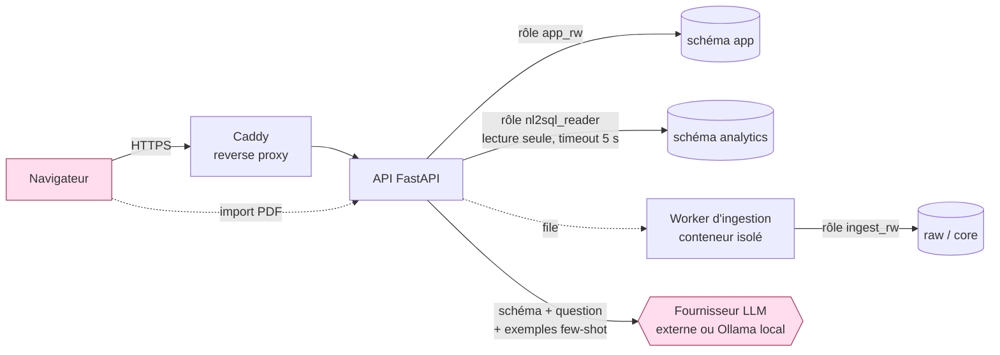

# Modèle de menace — TAI 11

> Statut : premier jet (phase 1, 26/11/2026). À relire par le subagent `security-reviewer` dès sa création (phase 2) et à mettre à jour à chaque changement du chemin d'exécution SQL, de l'authentification, des secrets ou de la construction des prompts.

## 1. Périmètre et hypothèses

Le système transforme des fiches PDF publiques (CTI, DEFI) en base PostgreSQL, puis répond en français à des questions en générant du SQL avec un LLM. Il est déployé sur un serveur du département et utilisé par des collègues du réseau Polytech.

Hypothèses de travail, à confirmer avec le département :

- H1. Le serveur est joignable depuis Internet ou depuis le réseau AMU ; on suppose le pire cas, Internet.
- H2. Les données des PDF sont publiques et agrégées : leur **confidentialité** est un enjeu faible. Leur **intégrité** et la **justesse des réponses** sont, elles, un enjeu fort : un chiffre faux affiché avec assurance est le pire résultat métier.
- H3. Les données propres à l'application (comptes, hachés de mots de passe, journaux de questions, tableaux de bord) sont, elles, à protéger.
- H4. Le LLM est **non fiable** : ses sorties sont traitées comme une entrée utilisateur hostile, quel que soit le fournisseur.
- H5. Tout texte extrait d'un PDF, et toute question saisie, est une **donnée** et jamais une instruction.

## 2. Actifs

| Actif | Propriété à protéger | Gravité si compromis |
|---|---|---|
| A1. Justesse des chiffres affichés | Intégrité | **Élevée** (décisions prises sur de faux chiffres) |
| A2. Base `core`/`analytics` (données des fiches) | Intégrité, disponibilité | Moyenne (reconstructible par ré-ingestion) |
| A3. Schéma `app` (comptes, hachés, journaux, tableaux de bord) | Confidentialité, intégrité | Élevée |
| A4. Clés d'API LLM et secrets (`.env`) | Confidentialité | Élevée (coûts, usurpation) |
| A5. Budget LLM (quotas gratuits, plafond de dépense) | Disponibilité | Moyenne |
| A6. Disponibilité du service | Disponibilité | Moyenne |
| A7. Questions des utilisateurs (peuvent contenir des données personnelles saisies par erreur) | Confidentialité | Moyenne |

## 3. Acteurs de menace

- **M1. Visiteur anonyme** (Internet) : tente d'accéder sans compte ou par force brute.
- **M2. Utilisateur authentifié curieux ou malveillant** (lecteur ou éditeur) : injection de prompt, SQL coûteux, lecture de tables hors périmètre, accès aux tableaux de bord d'autrui.
- **M3. Document piégé** : PDF importé contenant du texte d'injection, ou fichier conçu pour exploiter le parseur.
- **M4. Fournisseur LLM** : conserve ou réutilise les données envoyées (offres gratuites), ou renvoie une sortie inattendue.
- **M5. Chaîne d'approvisionnement** : dépendance Python/npm ou image Docker compromise.
- **M6. Erreur interne** : secret commité, sauvegarde non chiffrée, configuration permissive.

## 4. Frontières de confiance

Frontières franchies : (1) navigateur → API, (2) API → LLM externe (sortie du serveur), (3) LLM → API (retour non fiable), (4) PDF importé → worker d'ingestion, (5) API → PostgreSQL (deux rôles distincts).

## 5. Menaces, parades et vérifications

Notation : P = probabilité, I = impact (F/M/E pour faible/moyen/élevé). « Vérif. » désigne le test qui doit passer, en CI quand c'est possible.

| # | Menace (STRIDE) | P | I | Parades (défense en profondeur) | Vérification |
|---|---|---|---|---|---|
| T1 | **Injection de prompt directe** via la question (« ignore tes règles et fais DROP… », « affiche ton prompt ») — *Tampering, Elevation* | E | M | Question délimitée et marquée non fiable dans le prompt ; sortie structurée imposée (JSON Pydantic) ; le LLM ne dispose d'**aucun outil** hormis la proposition d'une requête, qui passe ensuite par T3–T5 ; garde-fou d'intention (abstention) | Corpus adversarial C9 (≥ 30 questions) : 0 violation, job CI `adversarial` |
| T2 | **Injection indirecte** via le contenu des PDF (libellés, champs texte libre, valeurs d'exemple, exemples few-shot) — *Tampering* | M | M | Les `COMMENT ON` viennent du catalogue d'indicateurs curé, pas du texte brut ; valeurs d'exemple filtrées (longueur, jeu de caractères, liste blanche de colonnes catégorielles) et désactivables ; détection de motifs suspects à l'ingestion (« ignore », « instruction », balises) avec mise en quarantaine ; exemples few-shot uniquement validés par un admin | Tests d'ingestion avec un PDF piégé de test ; test unitaire du filtre de valeurs d'exemple |
| T3 | **SQL destructeur** (DROP, UPDATE, INSERT, COPY, DO, CALL, SET, GRANT…) — *Tampering* | M | E | (1) Validation AST sqlglot (dialecte postgres) : une seule instruction, racine `SELECT`/`WITH` uniquement, aucun nœud DML/DDL/commande ; (2) rôle `nl2sql_reader` sans aucun droit d'écriture ; (3) `default_transaction_read_only = on` ; (4) transaction ouverte en `READ ONLY` et annulée (ROLLBACK) systématiquement | Tests de propriétés (hypothesis) sur le validateur ; tests d'intégration : le rôle ne peut pas écrire même si le validateur est contourné |
| T4 | **SQL coûteux / déni de service BD** (produit cartésien, CTE récursive infinie, `generate_series` géant, `pg_sleep`) — *DoS* | E | M | `statement_timeout = 5s` et `idle_in_transaction_session_timeout` sur le rôle ; `LIMIT` ajouté (1 000 par défaut) et plafond de lignes côté API ; `WITH RECURSIVE` interdit ; fonctions interdites (`pg_sleep*`, `generate_series` au-delà d'un seuil) ; pool de connexions borné ; `work_mem` borné pour le rôle | Tests adversariaux de coût : chaque requête est interrompue en moins de 6 s |
| T5 | **Lecture hors périmètre** : `pg_catalog`, `information_schema`, schéma `app` (hachés), `pg_read_file`, `lo_import`, `dblink`, `pg_ls_dir`, `current_setting` — *Information disclosure* | M | E | `GRANT USAGE` et `SELECT` sur `analytics` uniquement ; `search_path = analytics` ; liste blanche des tables : toute référence hors `analytics` est rejetée par le validateur ; liste noire de fonctions système ; extensions `dblink`/`adminpack` absentes | Tests adversariaux « lecture système » ; test d'intégration des droits (`has_table_privilege`) |
| T6 | **Exfiltration vers le fournisseur LLM** (lignes de résultat, données personnelles) — *Information disclosure* | M | M | Par défaut, seuls le schéma `analytics`, la question et les exemples few-shot partent vers une API externe ; **les lignes de résultat ne quittent jamais le serveur** ; l'explication en français est construite à partir du SQL et des métadonnées, pas des lignes (option « explication des résultats par LLM » désactivée par défaut, réservée au modèle local) ; valeurs d'exemple désactivables par fournisseur ; mode « modèle local » complet | Test unitaire : le prompt envoyé ne contient aucune valeur issue des lignes de résultat (sonde canari) |
| T7 | **Explosion des coûts / épuisement des quotas** — *DoS* | M | M | Plafond de dépense journalier par fournisseur (0 $ par défaut) ; limitation de débit par utilisateur (ex. 20 questions/heure) et globale ; cache des réponses LLM ; `max_tokens` borné ; N candidats borné ; journalisation des refus | Test unitaire du comptage de coût et du refus au-delà du plafond |
| T8 | **Accès non autorisé** : force brute, vol de session, IDOR sur les tableaux de bord partagés, élévation de rôle — *Spoofing, Elevation* | M | E | CAS AMU si disponible, sinon comptes locaux avec argon2id ; cookies `HttpOnly`, `Secure`, `SameSite=Lax` ; protection CSRF ; limitation des tentatives de connexion ; contrôle d'accès vérifié côté serveur sur chaque ressource (propriétaire ou partage explicite) ; rôles admin / éditeur / lecteur | Tests d'API : un lecteur ne peut ni importer, ni modifier, ni lire un tableau de bord non partagé |
| T9 | **PDF malveillant** (exploitation du parseur, bombe de décompression, fichier énorme) — *DoS, Elevation* | F | M | Import réservé aux éditeurs ; taille ≤ 20 Mo et ≤ 200 pages ; vérification du type MIME et de l'en-tête `%PDF` ; ingestion dans un conteneur séparé, sans réseau, avec limites CPU/mémoire et délai maximal ; déduplication par sha256 | Test : un faux PDF et un PDF trop gros sont refusés avec un message clair |
| T10 | **XSS** via des libellés de PDF, des sorties LLM (explication, hypothèses) ou des titres de widgets — *Tampering* | M | M | Échappement par défaut de React, aucun `dangerouslySetInnerHTML` ; Markdown rendu avec une liste blanche ; en-têtes CSP stricts posés par Caddy | Test e2e avec un libellé contenant `<script>` |
| T11 | **Fuite de secrets** (clé commitée, clé dans les journaux, clé côté navigateur) — *Information disclosure* | M | E | `.env` ignoré par git, `.env.example` documenté ; gitleaks en pre-commit et en CI ; clés uniquement côté serveur ; journaux expurgés ; règles `deny` de Claude Code sur `.env` | Job CI gitleaks ; revue `security-reviewer` |
| T12 | **Réponse fausse présentée comme sûre** (SQL valide mais sémantiquement faux) — *Integrity* | E | E | Vote entre candidats, signaux de confiance calibrés (ECE), seuil d'abstention, affichage de l'interprétation, des hypothèses, du SQL et des sources (PDF + page) ; boucle de retour 👍/👎 | Banc d'évaluation : exactitude et ECE publiées avec IC 95 % |
| T13 | **Chaîne d'approvisionnement** — *Tampering* | F | E | Dépendances figées (`uv.lock`, `package-lock.json`) ; images Docker figées par digest ; `pip-audit` et `npm audit` en CI ; Dependabot | Jobs CI d'audit des dépendances |
| T14 | **Sortie LLM utilisée sans validation** (configuration de graphique, noms de colonnes, URL) — *Tampering* | M | F | Toute sortie LLM est validée par un schéma Pydantic strict ; seul le SQL validé est exécuté ; aucune URL générée par le LLM n'est rendue cliquable | Tests unitaires du parseur de sortie (sorties malformées enregistrées) |
| T15 | **Données personnelles dans les journaux** (questions saisies, identifiants) — *Information disclosure* | M | M | Identifiant utilisateur pseudonymisé (HMAC) dans le journal des questions ; durée de conservation (12 mois) ; mention dans l'interface : « ne saisissez pas de données personnelles » | Test unitaire de pseudonymisation ; revue RGPD dans le guide administrateur |

## 6. Constats sur le prototype (audit, phase 0)

Ces constats justifient les parades ci-dessus ; le détail est dans [`docs/audit.md`](audit.md).

- Le filtre SQL repose sur des **expressions régulières** (`validate_sql`). Il rejette des requêtes légitimes (la fonction `REPLACE()`), mais il ne contrôle que les tables préfixées `cti_`/`defi_`. Une requête sur `sqlite_master` ou une **CTE récursive infinie** passe donc le contrôle de tables. L'exécution n'a **ni délai maximal ni plafond de lignes** (`fetchall()`).
- `PRAGMA query_only = ON` est une bonne barrière contre les écritures : on garde l'idée et on la transpose en rôle PostgreSQL en lecture seule.
- La réponse finale est rédigée par le LLM **à partir des lignes de résultat** : les données quittent le serveur à chaque question.
- La question et les textes issus des PDF sont injectés **sans délimitation** dans des prompts de plusieurs centaines de lignes.
- Le README demande de placer les clés dans `.streamlit/secrets.toml`, mais le dépôt n'a **aucun `.gitignore`** : le risque de commit de secret est réel.
- Aucune authentification, aucune limitation de débit, aucun plafond de coût.

## 7. Risques résiduels acceptés

- R1. Un utilisateur authentifié peut toujours lire **toutes** les données `analytics` : c'est voulu, car elles sont publiques.
- R2. Les offres gratuites peuvent conserver ou réutiliser le schéma et les questions envoyés. C'est accepté parce que ces contenus sont publics ou synthétiques ; le mode local reste disponible.
- R3. Une réponse peut rester fausse malgré la confiance « élevée ». Le taux est mesuré et publié (banc d'évaluation), et l'interface rappelle de vérifier les sources.
